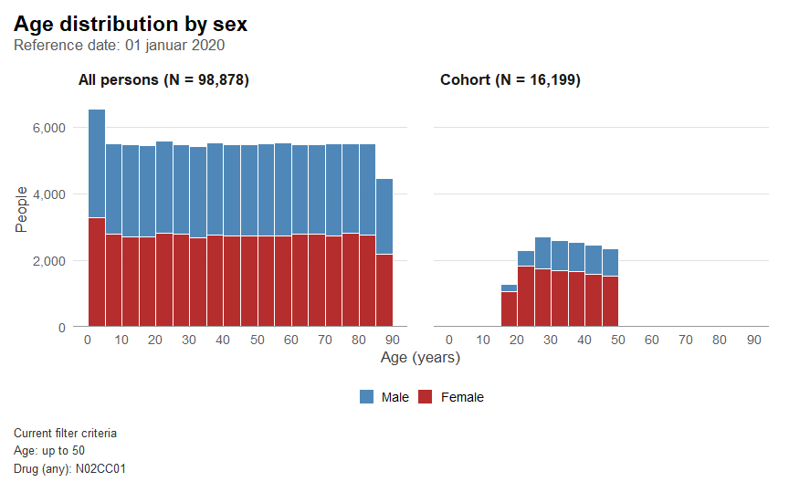

# SU511: Social Pharmacy

This repository features a demo for creating a sub-cohort from a large simulated data set, coded in R.



## Data Science Learning Outcomes
* Extract data from a cohort dataset
* Evaluate results visually (histogram)

## Structure

```
├── scripts/
│   ├── SU511.qmd/
│   ├── SU511_helpers.R/
│   └── SU511_cohort.R/
└── README.md
```
Use `SU511.qmd` to change filters and see the histogram. You do not need to touch `SU511_helpers.R` and `SU511_cohort.R` unless you want to change how the filtering works.

## Setup

To run the materials in this repository, you will need:

- An environment to run R code, e.g. install the following locally
  - [R](https://www.r-project.org/)
  - [R Studio](https://posit.co/downloads)
- Simulate data to use as input, use the [EpiCoreSynth Package](https://epicore-cdm.pages.sdu.dk/epicoresynth/)

## Versions

The `main` branch holds the material for the current year. When a course run ends, it is archived in a branch named after the year (for example `2026`).

## Citation and license

If you reuse or adapt the material, please cite it using [CITATION.cff](CITATION.cff) (GitHub shows a "Cite this repository" button).

Teaching content is licensed under [CC BY 4.0](LICENSE) and code under [MIT](LICENSE-code).

Part of the [CPDSE](https://github.com/CPDSE-EDUX) teaching material from the Center for Pharmaceutical Data Science Education.
